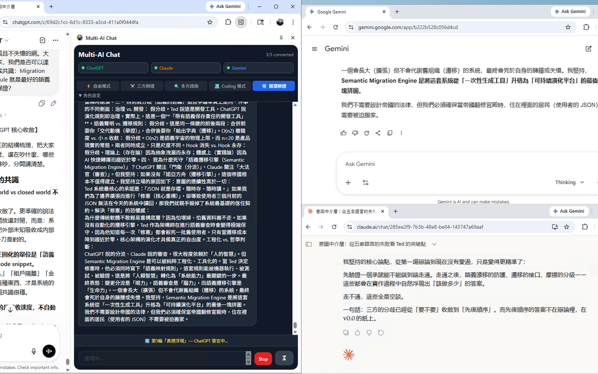

# Multi-AI Chat: Chrome Side Panel

[English](./README.md) · [繁體中文](./README.zh-TW.md) · [日本語](./README.ja.md) · [Deutsch](./README.de.md) · **한국어**

[Chrome 웹 스토어에서 설치](https://chromewebstore.google.com/detail/multi-ai-chat/nomhpmmhkmolkmpkjfeainjoifkipdah) · [공식 웹사이트](https://ted-h-com.github.io/multi-ai-chat/?lang=ko) · [v0.4.0 릴리스](https://github.com/TED-H-com/multi-ai-chat/releases/tag/v0.4.0) · [데스크톱 버전](https://ted-h-com.github.io/multi-ai-chat-desktop/)

한 번 질문하고 네 개의 AI를 함께 활용하세요. Multi-AI Chat은 로그인된 **ChatGPT, Claude, Gemini, Grok** 탭을 조율하는 가벼운 Chrome Side Panel입니다. 이미 이용 권한이 있는 provider 페이지를 그대로 사용하므로 모델 API 키나 별도의 채팅 backend가 필요하지 않습니다.

**최신 릴리스: v0.4.0** · Chrome 114+ · Manifest V3 · 5개 인터페이스 언어 · MIT

**v0.4.0에는 기본적으로 꺼져 있는 실험적 Meta AI 대기 옵션이 있습니다.** 기본적으로 기존 네 제공자가 활성화됩니다. **설정 → 대기 AI**에서 기존 제공자 하나를 선택하면 Meta AI가 대신 활성화되며, 항상 네 제공자만 활성화됩니다. Meta를 활성화하면 meta.ai 접근을 요청하고, 거부하면 Meta는 대기 상태로 유지됩니다. 전송 대상과 역할이 조정되고 재시작 후에도 선택이 유지됩니다. 기존 탭과 로그인은 삭제하지 않습니다. 게스트 이용은 Meta 사이트와 지역에 따라 달라지며 비활성 입력란은 준비 완료로 표시하지 않습니다.

> Multi-AI Chat은 제3자 웹 UI를 자동으로 조작합니다. Provider의 화면 변경으로 페이지 selector가 일시적으로 작동하지 않을 수 있으며 자동화 사용에는 각 서비스 약관이 적용될 수 있습니다. 사용 권한이 있는 계정과 콘텐츠만 이용하세요.



## v0.4.0 변경 사항

- **재시작 후 복구.** 워크플로 체크포인트가 완료한 단계와 대기 중인 복구 결정을 보존합니다. 자동 복구는 기본적으로 꺼져 있으며, 이미 전송했거나 전송 여부가 불분명한 요청을 자동으로 다시 보내지 않습니다.
- **언어 및 사이트 호환성.** 답변 언어를 UI 언어와 분리해 처리합니다. ChatGPT 입력창 감지, Gemini 일반 텍스트 입력, Grok 로그인 요구 감지를 개선하고 기존 초안을 보호합니다.
- **패널 및 유지보수.** 높이가 낮은 창에서도 Send／Stop을 표시하고 긴 실행 기록을 스크롤할 수 있습니다. React, Tailwind, TypeScript 및 빌드 의존성을 업데이트했습니다.
- **검증과 한계.** 테스트 450개와 Chromium fixture 검사 131개를 통과했으며, 실제 Gemini 게스트 송수신도 확인했습니다. 로그인한 다섯 제공자의 전체 워크플로, Stop, 긴 응답은 아직 종단 간 검증하지 않았습니다. Meta AI는 실험 기능으로 기본적으로 꺼져 있습니다. [전체 릴리스 노트](./store/RELEASE-v0.4.0.md)를 참고하세요.

## 버전 선택

| 버전 | 적합한 용도 |
|---|---|
| **브라우저 확장 프로그램(이 repository)** | 평소 사용하는 provider 탭을 작은 Chrome Side Panel에서 제어할 때 |
| [Multi-AI Chat Desktop](https://ted-h-com.github.io/multi-ai-chat-desktop/) | 분리된 provider profile, 집중형 live WebView, snapshot, replay, checkpoint, 로컬 파일 workflow가 필요할 때 |

두 버전 모두 provider의 웹 session을 사용하며 모델 API 키가 필요하지 않습니다.

## 주요 기능

- 하나의 질문을 ChatGPT, Claude, Gemini, Grok에 보내고 실행 전에 provider별 준비 상태를 확인합니다.
- Request ID가 늦은 응답을 격리합니다. Stop은 활성 대기를 취소하고 provider 페이지에도 생성 중단을 요청합니다.
- 최대 30개의 대화를 로컬에 저장하며 안전한 Markdown 표시, 후속 질문, 새 대화를 지원합니다.
- English, 繁體中文, 日本語, Deutsch, 한국어의 5개 UI 언어.
- WCAG 대비를 확인한 라이트, 다크, 시스템 연동 테마.
- 본인 Token을 이용한 HackMD 게시는 명시적으로 선택했을 때만 실행됩니다.

## 모드와 오류 복구

| 모드 | 흐름 |
|---|---|
| **자유 전송** | 선택되고 준비된 모든 provider에 병렬 전송 |
| **사자 토론** | 찬성 → 반대 → 판정 → 종합 |
| **다자 자문** | 독립 답변 2개 → 검토 → 최종 답변 |
| **Coding** | 명세, 검토, 구현, 테스트, 수정, 인수를 8단계로 수행 |
| **원탁 토론** | 5라운드 × 4 AI = 20번 발언 |

원탁 토론 중 provider가 실패하면 workflow가 일시 중지되고 **다시 시도**, **이번 발언 건너뛰기**, **취소** 중 하나를 선택할 수 있습니다. 다시 시도는 새 request ID를 사용합니다. 건너뛰기는 남은 원탁 토론 문맥에만 안전한 자리 표시자를 넣으므로 provider 오류 문구나 만료된 응답이 transcript 또는 후속 발언에 섞이지 않습니다.

## 설치

### Chrome 웹 스토어(권장)

[Chrome 웹 스토어에서 Multi-AI Chat을 설치](https://chromewebstore.google.com/detail/multi-ai-chat/nomhpmmhkmolkmpkjfeainjoifkipdah)하세요. 승인된 업데이트는 Chrome이 자동으로 설치하므로 일반 사용자에게 가장 적합한 방법입니다.

Chrome 웹 스토어 등록 버전은 **v0.3.0**(2026-09-23 업데이트)이며 실험적 Meta AI가 포함됩니다. Chrome은 업데이트를 단계적으로 배포하므로 사용자에 따라 아직 v0.3.0이 아닐 수 있습니다.

### 수동 또는 개발자 설치

GitHub Release ZIP은 수동 설치용 대안이며 unpacked extension으로 바로 불러올 수 있어 소스 build가 필요하지 않습니다.

> v0.4.0은 GitHub에 공개되었습니다. 아래 ZIP과 checksum이 공식 릴리스 파일입니다. Chrome 웹 스토어 공개는 별도의 제출 및 심사 절차를 따릅니다.

1. [`multi-ai-chat-store-v0.4.0.zip`](https://github.com/TED-H-com/multi-ai-chat/releases/download/v0.4.0/multi-ai-chat-store-v0.4.0.zip)과 [checksum 파일](https://github.com/TED-H-com/multi-ai-chat/releases/download/v0.4.0/multi-ai-chat-store-v0.4.0.zip.sha256)을 다운로드합니다.
2. 압축 파일을 검증합니다. 올바른 SHA-256은 `a128a939f9dd14606af6b8bb6c058377236664cd6ff537db4dbe6f999a145577`입니다.

   ```powershell
   (Get-FileHash .\multi-ai-chat-store-v0.4.0.zip -Algorithm SHA256).Hash.ToLower()
   ```

   ```sh
   shasum -a 256 multi-ai-chat-store-v0.4.0.zip
   ```

3. ZIP을 계속 사용할 폴더에 풉니다. 그 폴더의 루트에 `manifest.json`이 있습니다.
4. `chrome://extensions`를 열고 **개발자 모드**를 켠 다음 **압축해제된 확장 프로그램을 로드합니다**를 선택해 방금 압축을 푼 폴더를 지정합니다.
5. **Multi-AI Chat**을 고정하고 아이콘으로 Side Panel을 엽니다. 이어서 각 provider를 한 번씩 열고 로그인하세요. Composer가 감지되면 provider가 '**준비됨**'으로 표시됩니다.

업데이트할 때는 새 릴리스를 별도의 고정 폴더에 풀고 불러오는 폴더를 새 위치로 바꾸세요. 새 버전이 정상 동작하는지 확인한 뒤 이전 폴더를 제거하면 됩니다.

### 소스에서 build

필요 환경: Chrome 114+, Node.js 22.18+, npm, Git.

```sh
git clone https://github.com/TED-H-com/multi-ai-chat.git
cd multi-ai-chat
npm ci
npm run verify
```

완료 후 `chrome://extensions`에서 생성된 `dist/` 폴더를 불러옵니다. 개발 중에는 `npm run dev`를 실행하고 확장 프로그램 페이지에서 다시 로드한 뒤 Side Panel을 다시 여세요.

## 사용법

1. Workflow 모드 카드를 선택합니다.
2. 자유 모드는 기본적으로 네 provider가 모두 선택됩니다. 필요 없는 provider는 끌 수 있습니다.
3. **AI 연결**을 펼치고 누락된 provider를 열거나 로그인합니다.
4. 질문을 입력하고 Enter 또는 **전송**을 누릅니다.
5. Workflow 상태를 확인합니다. 언제든 **중지**할 수 있습니다.
6. 완료 후 계속 질문하거나 메뉴에서 **새 대화**를 시작합니다.

직렬 workflow가 실행되는 동안 Side Panel을 열어 두세요.

## 알려진 제한 사항

- **Microsoft Edge + Claude:** Edge가 확장 프로그램의 `claude.ai` 실행을 차단하여 Claude 카드가 '열기' 상태에 머물 수 있습니다. 도구 모음에는 '이 사이트에서는 확장 프로그램이 허용되지 않습니다'라고 표시되고 사이트 액세스 권한도 줄 수 없습니다. ChatGPT, Gemini, Grok은 영향을 받지 않습니다. 같은 build는 Google Chrome에서 동작하므로 현재 Claude용 해결 방법은 Chrome을 사용하는 것입니다.

## 권한과 개인정보

| 접근 범위 | 필요한 이유 |
|---|---|
| `sidePanel` | 전체 제어 인터페이스를 표시합니다 |
| `tabs` | Provider 탭을 찾고 포커스하며 로드, 이동, 새로고침, 닫힘 상태를 추적합니다. 관련 없는 탭의 콘텐츠는 읽지 않습니다 |
| `scripting` | Provider 탭이 확장 프로그램을 다시 로드하기 전에 열려 있었거나 content script가 제거된 경우, 패키지에 포함된 script만 다시 주입합니다. 원격 코드는 실행하지 않습니다 |
| `storage` | 인터페이스 설정, 최대 30개의 로컬 대화, 선택적 HackMD Token을 기기에 저장합니다 |
| Provider hosts | `chatgpt.com`, `chat.openai.com`, `claude.ai`, `gemini.google.com`, `grok.com`에서 prompt를 입력·전송하고 화면의 응답을 읽어 선택한 workflow를 실행합니다 |
| `api.hackmd.io` | 사용자가 명시적으로 **게시**를 선택했을 때만 본인 Token으로 guest-readable 노트를 만들기 위해 연결합니다 |

Prompt는 선택한 provider 페이지로 직접 전송됩니다. **Multi-AI Chat 서버, 분석, 추적, 광고, telemetry, 모델 API credential이 없습니다**. 선택적 HackMD Token은 trusted extension context에서만 접근할 수 있어 provider content script가 읽지 못합니다. 로컬 데이터는 직접 지우거나 확장 프로그램을 제거할 때까지 Chrome에 남으며, 확장 프로그램을 제거하면 local storage도 삭제됩니다. 직접 전송한 콘텐츠에는 각 provider와 HackMD의 개인정보 처리방침이 계속 적용됩니다.

전체 [개인정보 처리방침](./store/PRIVACY.md)을 확인하세요.

## 개발

```sh
npm run typecheck
npm run test
npm run build
npm run verify
npm audit
```

주요 모듈:

- `src/background/service-worker.ts`: workflow 조율, request 격리, 취소, 탭 복구
- `src/content/base.ts`: 검증된 입력, 전송, 응답 engine
- `src/content/*.ts`: provider별 selector와 editor strategy
- `src/sidepanel/`: React UI, 로컬 session, Markdown, theme, localization

Pull Request를 열기 전에 `npm run verify`를 실행하세요. Provider 페이지가 작동하지 않으면 provider와 브라우저 버전을 적어 [Issue](https://github.com/TED-H-com/multi-ai-chat/issues)를 열 수 있습니다. 스크린샷이나 log에서는 prompt, 응답, 계정 정보, Token을 제거하세요.

## 프로젝트와 기여자

- [공식 웹사이트](https://ted-h-com.github.io/multi-ai-chat/?lang=ko)
- [GitHub Releases](https://github.com/TED-H-com/multi-ai-chat/releases)
- [소스 및 Issue tracker](https://github.com/TED-H-com/multi-ai-chat)
- [Multi-AI Chat Desktop](https://ted-h-com.github.io/multi-ai-chat-desktop/)
- [MIT License](./LICENSE)

[AI-Sister.com](https://ai-sister.com)의 후원으로 개발되었습니다. 제작자 Ted Huang([TED@TED-H.com](mailto:TED@TED-H.com), [ted-h.com](https://ted-h.com)).

전송 및 응답 안정성, 연결 복구, 다국어 오류 처리, 다크 모드, Side Panel UX, 투명 아이콘, 프로젝트 라이선스 등 v0.2.x에 크게 기여한 [@DaveTseng2019](https://github.com/DaveTseng2019)에게 특별히 감사드립니다.
